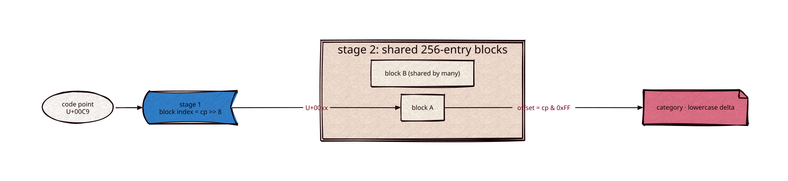

# unicode

Part of [Kronuz C++ Libraries](https://github.com/Kronuz/cpp-libraries), a collection of small, reusable C++ libraries.

[](https://github.com/Kronuz/unicode/actions/workflows/ci.yml)
[](LICENSE)


Unicode general categories, simple lowercase mappings, and lenient UTF-8 decoding for
C++20, as two-stage lookup tables generated from the Unicode Character Database
(Unicode 17.0.0). Header-only, no dependencies.



## ✨ Highlights

- `unicode::category_of(c)`: the general category, as `unicode::category`
  (`uppercase_letter`, `decimal_number`, `connector_punctuation`, ...). Code points
  above U+10FFFF are `unassigned`.
- `unicode::tolower(c)`: the simple (one-to-one) lowercase mapping from
  `UnicodeData.txt`; code points without one map to themselves.
- `is_letter`, `is_mark`, `is_number`: category ranges.
- `unicode::next_utf8(p, end)`: decodes one code point and advances `p`. A byte that
  does not start a valid, shortest-form sequence decodes as itself (ISO-8859-1) and
  advances one byte, so arbitrary bytes never fail and never read past `end`.
- `unicode::append_utf8(out, c)`: encodes `c` onto a `std::string`.

All lookups are `constexpr`. The tables split code points into 256-entry blocks and
share identical blocks: 75.8 KB in total (categories 45.8 KB, lowercase deltas 30 KB).

## 📦 Installation

Requires a C++20 compiler; CMake 3.14 or newer for the CMake route. CI builds it on
Linux (x86_64, arm64), macOS (arm64, x86_64), and FreeBSD, plus ASan, UBSan, and TSan
builds.

```cmake
include(FetchContent)
FetchContent_Declare(unicode
  GIT_REPOSITORY https://github.com/Kronuz/unicode.git
  GIT_TAG        main)
FetchContent_MakeAvailable(unicode)

target_link_libraries(my_app PRIVATE unicode::unicode)
```

## 🚀 Quick start

```cpp
#include "unicode.hh"

#include <cstdio>
#include <string_view>

int main() {
	std::string_view s = "Ünïcode, 2026!";
	std::string lower;
	for (const char *p = s.data(), *end = p + s.size(); p < end;) {
		char32_t c = unicode::next_utf8(p, end);
		if (unicode::is_letter(c) || unicode::is_number(c)) { unicode::append_utf8(lower, unicode::tolower(c)); }
	}
	std::puts(lower.c_str());   // ünïcode2026
}
```

## 🧪 Correctness

The test checks a digest of the category and lowercase of every code point, spot
values, a UTF-8 round trip, and Latin-1 fallback for invalid sequences. Given a
`code_point category lowercase` dump it also compares every code point against it;
the tables match Xapian 2.1.0's `Unicode::get_category` and `Unicode::tolower` on all
1,114,112 code points (categories are numbered in the same order).
`fuzz/fuzz_utf8.cc` is a libFuzzer target (35M runs clean under ASan and UBSan).

## ⚡ Performance

`next_utf8` decides ASCII on a window of eight bytes (one load and one mask), so text that is
mostly ASCII decodes about twice as fast as with a byte-by-byte decoder. Multi-byte sequences,
invalid bytes and the last seven bytes of the text go through an out-of-line decoder that returns
in registers. No kind of input measured is slower than the byte-by-byte decoder at `-O3`, random
bytes included: a
test of the first byte alone decodes English faster still (5.7x), but about half the bytes of
random input are ASCII, so that test is mispredicted on every other code point (0.7x). On an
Apple M4 Pro (Apple clang 17, `-O3`), in ns per code point from `bench/bench.cc` ("pipeline"
decodes, then adds `category_of` and `tolower`; the speedup over the byte-by-byte decoder is in
parentheses):

| text | decode | pipeline |
| --- | ---: | ---: |
| English words | 0.76 (2.3x) | 0.65 (2.8x) |
| One accented letter in 33 | 1.09 (1.7x) | 1.08 (1.8x) |
| English with accents and quotes | 0.98 (1.8x) | 1.00 (1.9x) |
| English read as Latin-1 | 1.10 (1.6x) | 1.07 (1.7x) |
| Cyrillic words | 1.6 (1.2x) | 2.0 (1.3x) |
| CJK with ASCII digits and spaces | 1.6 (1.1x) | 1.9 (1.2x) |
| Emoji | 2.8 (1.3x) | 3.1 (1.2x) |
| Every length equally likely | 4.7 (1.3x) | 5.1 (1.3x) |
| Random bytes (mostly invalid UTF-8) | 2.5 (1.2x) | 2.8 (1.2x) |

On an Apple M1 Pro the speedups run from 1.2x (emoji) to 2.3x (English words). On an Intel
i9-9980HK they run from 1.0x (Cyrillic) to 2.0x (English words); built at `-O2` the Cyrillic row
reads 0.9x there. The same decode loop runs up to 30% apart on the i9 depending on where the
compiler places it, so `bench/bench.cc` times each decoder at eight alignments of the loop and
prints the mean, the worst alignment and the spread of the baseline.

```sh
cmake -B build -DCMAKE_BUILD_TYPE=Release && cmake --build build
./build/unicode_bench [FILE]
```

[docs/perf/next-utf8.md](docs/perf/next-utf8.md) has the method, the numbers on three machines and the variants that did not win. [CHANGELOG.md](CHANGELOG.md) lists the changes with their measurements.

## 🔁 Regenerating the tables

```sh
curl -O https://www.unicode.org/Public/17.0.0/ucd/UnicodeData.txt
tools/gen_tables.py UnicodeData.txt 17.0.0 > unicode_tables.hh
tools/gen_tables.py --check UnicodeData.txt DUMP   # compare with a reference dump
```

## 🛠️ Building and testing

```sh
cmake -S . -B build && cmake --build build && ctest --test-dir build
build/unicode_bench FILE
```

## 🎯 When to use it

- ✅ Classifying and lowercasing text exactly as Xapian does, with no ICU dependency.
- ❌ Full case folding, normalization, or word breaking: use ICU.

## 📚 Documentation

- [AGENTS.md](AGENTS.md): repository map and invariants.

## 🤝 Contributing

Issues and pull requests are welcome. Read [AGENTS.md](AGENTS.md) first. CI must
pass on every platform.

## 📄 License

MIT, Copyright (c) 2026 Germán Méndez Bravo. See [LICENSE](LICENSE).
The generated tables derive from the Unicode Character Database under the
Unicode License v3; see [LICENSE-UNICODE](LICENSE-UNICODE).
